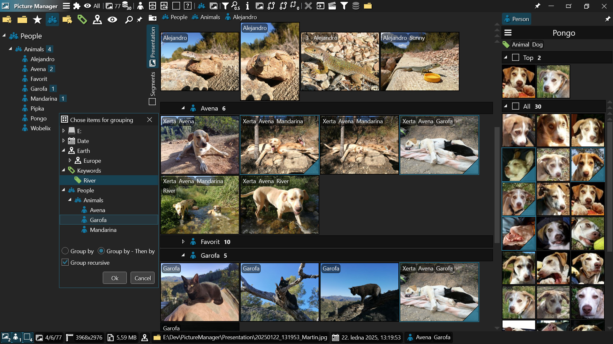
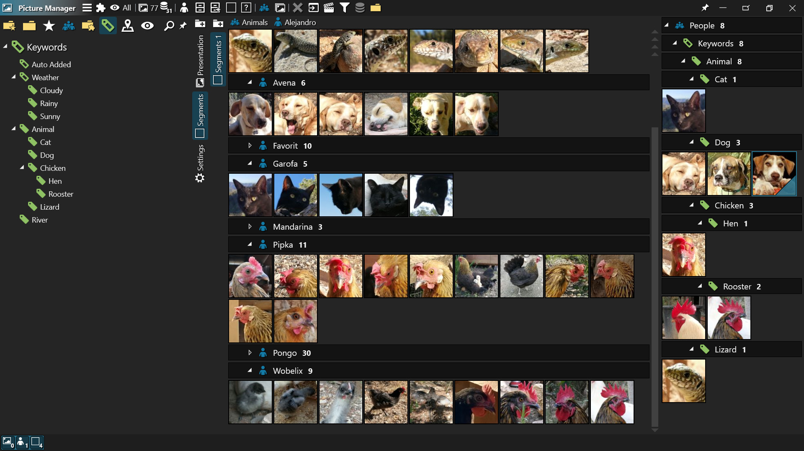
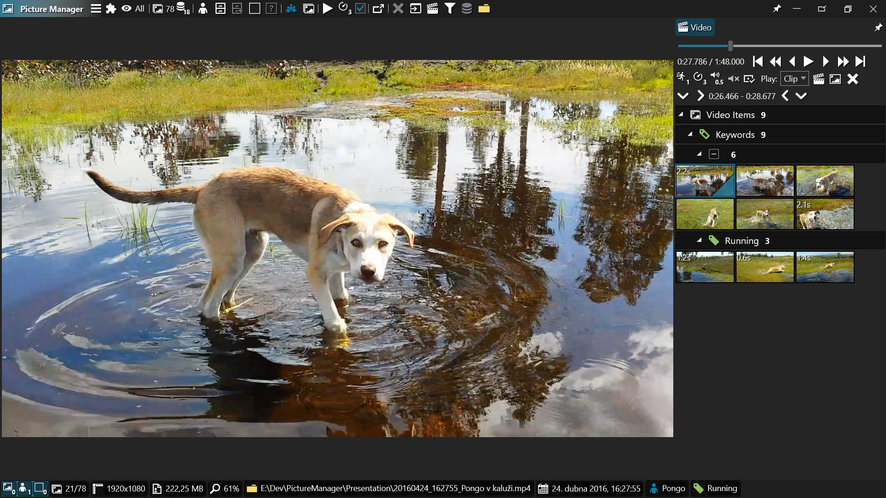

# Picture Manager

**Picture Manager is a photo and video library manager for browsing, organizing, annotating and viewing media files.** It combines folder-based browsing with a searchable metadata catalog, people and keyword organization, image-region annotations, video clips, and batch media operations.

The application is also a real-world example of the UI and infrastructure libraries used to build it: [MH.Utils](https://github.com/martin-holy/MH.Utils), [MH.UI](https://github.com/martin-holy/MH.UI) and [MH.UI.WPF](https://github.com/martin-holy/MH.UI.WPF).

[](https://github.com/martin-holy/PictureManager/releases/tag/v2.35.0)
[](https://github.com/martin-holy/PictureManager/releases/tag/android-v1.2.0)
[](./LICENSE)

[Telegram channel](https://t.me/PictureManager)

## Screenshots


People, Grouping, Thumbnails, Person detail


Keywords, Segments, People


Fullscreen video, Video detail

## Features

### Browse and organize a media library

- Browse images and videos from their existing folders. The application indexes media items and creates cached thumbnails; it does not require importing or moving the original files into a separate library.
- Organize folders with favorites and **Folder Keywords**. A Folder Keyword can combine the contents of multiple folders into one logical collection.
- Create **Viewers** as working sets with included and excluded folders. Use them to focus on a particular part of a larger library.
- Navigate the library through categories for folders, ratings, image sizes, people, folder keywords, keywords and geographic locations.
- Search across the category tree and load media by folder, person, keyword or GeoName.
- Browse large collections through thumbnail views with configurable size, scale, sorting, grouping and shuffling. Multiple media views can be opened independently.

### Metadata, keywords and filtering

- Organize media with ratings, comments, hierarchical keywords, people and geographic names.
- Create groups of people and keywords, and arrange them with drag-and-drop.
- Apply **And**, **Or** and **Not** filters to combine or exclude selected tags.
- Read geographic coordinates from media files, create GeoNames from GPS coordinates, or look up place names using the GeoNames service.
- Edit comments directly and edit ratings, people, keywords and locations across selected media items.
- Save supported image metadata back to JPEG files without re-encoding the image data. The application also stores image-region annotations in JPEG metadata.

### Image and video viewing

- Open images and videos in a dedicated viewer with keyboard and mouse navigation.
- Zoom, pan and fit images to the available view; inspect images at their actual size.
- Run a slideshow with a configurable interval, including support for panoramic images.
- Play videos and define timestamp-based clips. Clips can be grouped, reordered and played individually or as collections, with playback speed and volume settings.
- View video details and thumbnails independently of the main media browser.

### People and image segments

- Select square regions of images as **segments** and associate them with people and keywords.
- Use segments as person thumbnails and profile images. Each person can have a curated set of top segments.
- Review and organize segments in multiple segment views, or collect them in the Segments drawer.
- Load media items from a person or selected segments, assign selected segments to the same person, and mark segments as unknown.
- Export selected segments to image files.

### Batch operations and tools

- Copy, move, rename and delete media files from the browser.
- Rotate, resize and compress selected images or images in a folder.
- Rebuild thumbnails and reload or save media metadata.
- Create a video from a selection of images. FFmpeg can be configured in application settings for this operation.
- Compare images using average-hash or perceptual-hash comparison, with an adjustable similarity threshold.

## Application structure

Picture Manager separates its shared application logic from the platform-specific presentation:

- **PictureManager.Common** – shared application and domain layer used by the platform front-ends.
- **PictureManager.Windows.WPF** – Windows desktop front-end, WPF views, platform integration, dialogs, converters and media presentation.
- **PictureManager.Android** – Android front-end maintained as a separate project.

The Windows application uses the following libraries:

- **[MH.Utils](https://github.com/martin-holy/MH.Utils)** – common utilities and infrastructure, including the SimpleDB storage engine and imaging/metadata functionality.
- **[MH.UI](https://github.com/martin-holy/MH.UI)** – platform-independent UI controls, view models and interaction logic.
- **[MH.UI.WPF](https://github.com/martin-holy/MH.UI.WPF)** – WPF presentation layer and platform-specific control implementations.

The application is a useful example of these libraries working together in a non-trivial product: the shared UI logic is hosted by WPF controls, while the application-specific views and platform services are kept in the Windows front-end.

### A few implementation details

- The media files remain in their original folders. The application maintains its own database and thumbnail cache for browsing and organization.
- The UI is built around MVVM and the collection/tree controls provided by MH.UI and MH.UI.WPF.
- Media browsing uses virtualized collection views with grouping, sorting, selection and multiple independent views.
- Image metadata writing is designed to preserve the encoded image data; saving supported metadata does not require recompressing the JPEG.
- The Windows front-end loads optional UI plugins from the `plugins` directory. The solution includes **MovieManager**, which adds a separate movie-management feature set.

## Downloads

| Platform | Version | Download |
|---|---:|---|
| Windows (WPF) | 2.35.0 | [GitHub release](https://github.com/martin-holy/PictureManager/releases/tag/v2.35.0) |
| Android | 1.2.0 | [GitHub release](https://github.com/martin-holy/PictureManager/releases/tag/android-v1.2.0) |

## Building from source

The Windows project targets **.NET 8 for Windows** and uses WPF. The project currently targets **x86**.

The solution is organized to use sibling checkouts of the related repositories. For a local development setup, place the repositories next to each other:

```text
workspace/
├── MH.Utils/
├── MH.UI/
├── MH.UI.WPF/
├── PictureManager.Common/
├── PictureManager/
├── PictureManager.Android/    # Android front-end
└── MovieManager/               # Optional plugin and its projects
```

Clone the public repositories:

```bash
git clone https://github.com/martin-holy/MH.Utils.git
git clone https://github.com/martin-holy/MH.UI.git
git clone https://github.com/martin-holy/MH.UI.WPF.git
git clone https://github.com/martin-holy/PictureManager.git
git clone https://github.com/martin-holy/MovieManager.git
```

`PictureManager.Common` is a required project reference and must also be available at the sibling path shown above. The Android front-end and `MH.UI.Android` are needed only when building the Android project. MovieManager is an optional plugin at runtime, although its projects are included in the solution.

Open `PictureManager.sln` in Visual Studio 2022 or later. The project uses local project references in **Debug** configuration and NuGet packages in **Release** configuration. If you do not use the expected sibling directory layout, update the project references accordingly.

The Windows application loads optional plugins from `plugins/<PluginName>`; the MovieManager plugin is configured to load from `plugins/MovieManager`.

## License

Picture Manager is licensed under the [MIT License](./LICENSE).
